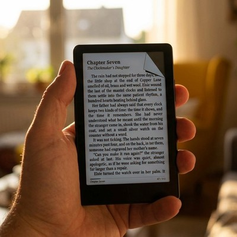

# Crosspoint-Addons

One firmware with all add-ons for the
[CrossPoint Reader](https://github.com/crosspoint-reader/crosspoint-reader) firmware.

## Included add-ons

| Add-on | What it does | Preview |
| --- | --- | --- |
| [Crosspoint-Dogear](https://github.com/Menrix/Crosspoint-Dogear) | Bookmarks show as a folded page corner |  |
| [Crosspoint-ToDoList](https://github.com/Menrix/Crosspoint-ToDoList) | To-do and shopping lists you tick on the reader, fill from phone or computer |  |

## Install

Get the file for your device from **[Releases](../../releases)**: `…-x4pro.bin` for the X4 Pro,
`…-x3-x4.bin` for the X3 and X4. Copy it to the SD card and use
**Settings → SD Card Firmware Update**. Later updates: **Settings → Check for Updates**.
It already contains every add-on, so don't install them separately.

> **X3 and X4: not tested.** No touch screen there, so everything runs over the buttons, which
> makes the add-ons harder to use.

## How it is built

**Actions → Build CrossPoint with all add-ons → Run workflow** puts the add-ons listed in
[`addons.txt`](addons.txt) on the latest official CrossPoint release and publishes the firmware
under Releases. A new add-on is one more line in that file.

Made with the help of Claude.

## License

MIT, see [LICENSE](LICENSE). The add-ons keep their own licenses.
